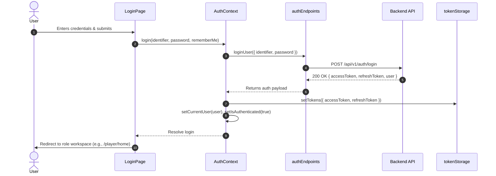
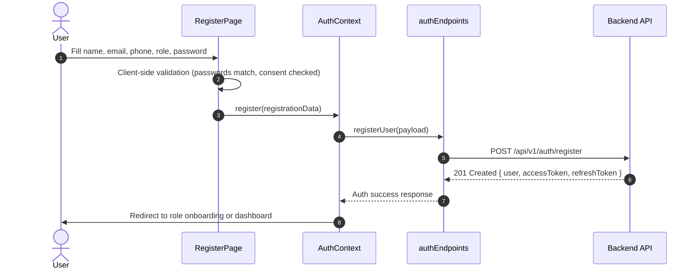

# Authentication & Authorization Flow — Khela Hobe

> [!NOTE]
> **Provisional Backend Contracts**: All endpoint URLs, JSON payloads, and token response envelopes in this document are **provisional** and designed to establish clear frontend integration conventions. Final contracts will be aligned with the backend engineering team.

---

## 1. Overview & Architecture

KHELA HOBE utilizes a dual-token JWT (JSON Web Token) authentication architecture combined with Role-Based Access Control (RBAC).

```
┌─────────────────┐       ┌─────────────────┐       ┌─────────────────┐
│   React UI      │ ----> │   AuthContext   │ ----> │  tokenStorage   │
│  (Login/Reg)    │       │ (State & Hooks) │       │ (JWT Storage)   │
└─────────────────┘       └─────────────────┘       └─────────────────┘
                                   │                         │
                                   ▼                         ▼
                          ┌─────────────────┐       ┌─────────────────┐
                          │   authEndpoints │ ----> │   axiosClient   │
                          │   (Service API) │       │ (Bearer & 401)  │
                          └─────────────────┘       └─────────────────┘
```

The authentication system is decoupled across five layers:
1. **`AuthContext.jsx`**: Global authentication state, reactive user object, role authorization helpers, and mock role switcher.
2. **`tokenStorage.js`**: Decoupled token storage interface (`getAccessToken()`, `setTokens()`, `clearTokens()`).
3. **`axiosClient.js`**: Axios interceptors that inject the `Authorization: Bearer <token>` header and orchestrate automatic 401 token refresh with a request queue mutex.
4. **`authEndpoints.js`**: Service layer defining provisional endpoints for login, registration, token refresh, and password recovery.
5. **`ProtectedRoute.jsx` & `RoleBasedRoute.jsx`**: Route guard components protecting role-specific workspace paths.

---

## 2. Token Lifecycle

### Token Specifications (Provisional)
- **Access Token**: Short-lived (recommended 15 minutes). Carries user identity, role, and permissions in its JWT claims payload.
- **Refresh Token**: Long-lived (recommended 7 to 30 days). Used exclusively to retrieve new access tokens upon expiration.

### Storage Abstraction (`tokenStorage.js`)
Currently implemented via browser `localStorage` for development simplicity and mock persistence:
- `getAccessToken()` / `setAccessToken(token)`
- `getRefreshToken()` / `setRefreshToken(token)`
- `setTokens({ accessToken, refreshToken })`
- `clearTokens()`

> [!TIP]
> In production with strict security requirements, `tokenStorage.js` can be refactored to rely entirely on `HttpOnly`, `SameSite=Strict`, `Secure` cookies without changing any consuming React components or services.

---

## 3. Authentication Sequences

### A. Login Flow



### B. Automatic Token Refresh on 401 (Refresh Mutex Queue)

When an access token expires while browsing, `axiosClient.js` queues concurrent outbound requests, requests a fresh token, and replays the original requests without user disruption:

```mermaid
sequenceDiagram
    autonumber
    actor User
    participant Client as axiosClient
    participant Mutex as Refresh Mutex
    participant API as Backend API
    participant Store as tokenStorage

    User->>Client: Fetch /matches/101 (Expired Token)
    Client->>API: GET /api/v1/matches/101 (Bearer Expired)
    API-->>Client: 401 Unauthorized
    Client->>Mutex: Check if refresh in progress
    Note over Mutex: Mutex locked; queue subsequent requests
    Client->>API: POST /api/v1/auth/refresh { refreshToken }
    alt Refresh Successful
        API-->>Client: 200 OK { accessToken, refreshToken }
        Client->>Store: Update tokens
        Client->>API: Replay GET /matches/101 (New Token)
        API-->>Client: 200 OK (Match Data)
        Mutex->>Client: Replay queued requests
    else Refresh Token Expired / Invalid
        API-->>Client: 401 / 403 Session Expired
        Client->>Store: clearTokens()
        Client->>User: Redirect to /login?expired=true
    end
```

### C. Registration & Role Assignment Flow



---

## 4. Role-Based Access Control (RBAC)

Khela Hobe defines four primary roles:

| Role | Constant | Default Workspace | Description |
| :--- | :--- | :--- | :--- |
| **Player** | `player` | `/player/home` | Discover matches, apply for rosters, purchase tickets, manage player profile. |
| **Organizer** | `organizer` | `/organizer/dashboard` | Host matches, review applications, create events, scan and verify tickets. |
| **Guardian** | `guardian` | `/guardian/dashboard` | Link child accounts, monitor sports activity, set safety boundaries, review alerts. |
| **Administrator** | `admin` | `/admin/dashboard` | Moderate flagged matches, manage sports catalog, resolve reports, oversee user accounts. |

### Route Protection Architecture

Route guarding is implemented in `src/routes/AppRoutes.jsx` using two protective wrappers:

1. **`ProtectedRoute`**: Verifies `isAuthenticated === true`. If unauthenticated, records `location.pathname` and redirects to `/login`.
2. **`RoleBasedRoute`**: Verifies `allowedRoles.includes(user.role)`. If unauthorized, redirects to `/unauthorized` with a clear explanation and navigation options.

```jsx
// Example Route Configuration
<Route
  path="/organizer/dashboard"
  element={
    <ProtectedRoute>
      <RoleBasedRoute allowedRoles={['organizer', 'admin']}>
        <OrganizerDashboardPage />
      </RoleBasedRoute>
    </ProtectedRoute>
  }
/>
```

---

## 5. Development Mode Role Switcher

For seamless rapid testing without logging in and out, the application includes a mock role switcher in development mode:

- Access via `useAuth().switchRole(newRole)` or the top navigation bar avatar menu.
- Switches between:
  - **Player**: `sakib.player@khelahobe.com`
  - **Organizer**: `rahim.organizer@khelahobe.com`
  - **Guardian**: `tasnim.guardian@khelahobe.com`
  - **Admin**: `admin@khelahobe.com`
- Instantly updates navigation items, permission checks, and workspace routing.

---

## 6. Provisional API Endpoint Contracts

### `POST /api/v1/auth/login`
```json
// Request
{
  "identifier": "sakib.player@khelahobe.com", // Email or phone
  "password": "SecurePassword123!",
  "rememberMe": true
}

// Response (200 OK)
{
  "success": true,
  "statusCode": 200,
  "message": "Login successful.",
  "data": {
    "accessToken": "eyJhbGciOiJIUzI1NiIsInR5cCI6IkpXVCJ9...",
    "refreshToken": "eyJhbGciOiJIUzI1NiIsInR5cCI6IkpXVCJ9...",
    "expiresIn": 900,
    "user": {
      "id": "usr-001",
      "name": "Sakib Hasan",
      "email": "sakib.player@khelahobe.com",
      "phone": "+8801712345678",
      "role": "player",
      "avatar": "https://images.unsplash.com/photo-1534528741775-53994a69daeb?w=150"
    }
  }
}
```

### `POST /api/v1/auth/refresh`
```json
// Request
{
  "refreshToken": "eyJhbGciOiJIUzI1NiIsInR5cCI6IkpXVCJ9..."
}

// Response (200 OK)
{
  "success": true,
  "statusCode": 200,
  "message": "Token refreshed successfully.",
  "data": {
    "accessToken": "eyJhbGciOiJIUzI1NiIsInR5cCI6IkpXVCJ9...",
    "refreshToken": "eyJhbGciOiJIUzI1NiIsInR5cCI6IkpXVCJ9...",
    "expiresIn": 900
  }
}
```

### `POST /api/v1/auth/forgot-password`
```json
// Request
{
  "email": "sakib.player@khelahobe.com"
}

// Response (200 OK)
{
  "success": true,
  "statusCode": 200,
  "message": "Password reset instructions have been sent to your email."
}
```

### `POST /api/v1/auth/reset-password`
```json
// Request
{
  "token": "reset-token-xyz123",
  "newPassword": "BrandNewPassword123!",
  "confirmPassword": "BrandNewPassword123!"
}

// Response (200 OK)
{
  "success": true,
  "statusCode": 200,
  "message": "Your password has been successfully reset. Please log in."
}
```
